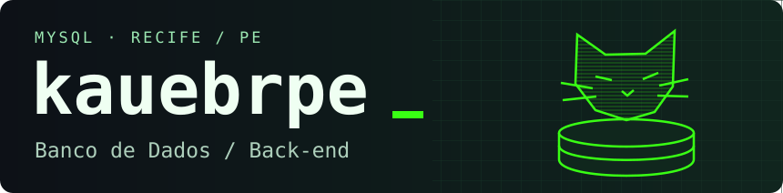

# Kauê de Carvalho Nascimento

**DBA em formação · SQL e MySQL · Back-end e APIs REST**  
Recife, Pernambuco

Estudo Análise e Desenvolvimento de Sistemas na **Faculdade Senac Pernambuco**. Nos projetos da graduação, trabalho com bancos relacionais e aplicações web. Integro o **COMPET Superior 2026 da FACEPE** no projeto Agenda Saúde Digital Tacaratu.

**Busco minha primeira oportunidade profissional, em estágio ou vaga júnior, com foco em Banco de Dados ou Back-end.**

**[LinkedIn](https://www.linkedin.com/in/kauedecarvalho/) · [Currículo Lattes](https://lattes.cnpq.br/1619694344615298) · [ORCID](https://orcid.org/0009-0000-1827-4606) · [E-mail](mailto:kauecarvnascimento@gmail.com)**

## Projetos

### Agenda Saúde Digital Tacaratu
Participo do projeto institucional de extensão tecnológica pelo COMPET Superior 2026 da FACEPE. O MVP acadêmico apresenta campanhas, agendas e ações de saúde de Tacaratu (PE). O repositório reúne a aplicação web e o trabalho de requisitos, documentação e testes.

**Node.js · Express · JavaScript** · [Explorar o MVP](https://github.com/kauebrpe/agenda-saude-tacaratu-mvp)

### Trama Conecta
Projeto Integrador voltado às confecções do Agreste pernambucano. O sistema acompanha clientes, pedidos e prazos, reúne indicadores em um painel administrativo e exporta dados em CSV. A aplicação integra uma API REST à interface em React, com persistência em MySQL e migrações com Flyway.

**Java · Spring Boot · JPA · MySQL · React** · Repositório privado

### Estudos em ADS
Atividades de programação, desenvolvimento web e banco de dados realizadas durante a graduação. [Consultar os exercícios](https://github.com/kauebrpe/ADS_FACULDADE)

## Competências desenvolvidas na graduação

- **Banco de Dados** — modelagem relacional, chaves primárias e estrangeiras, definição de tabelas, consultas e transações em MySQL.
- **Back-end** — operações CRUD, persistência com JPA, migrações com Flyway e integração por APIs REST.
- **Aplicações web** — JavaScript, React, Vite, HTML e CSS.
- **Desenvolvimento em equipe** — versionamento com Git, issues, pull requests, documentação e testes automatizados.

## Próximos estudos

Quero aprofundar SQL, comparar planos de execução e estudar indexação, backup e recuperação. Também pretendo ampliar minha prática com PostgreSQL e Linux. Em **cibersegurança**, meu interesse está na proteção dos dados e no controle de acesso a APIs.

## Formação

**Tecnologia em Análise e Desenvolvimento de Sistemas · Faculdade Senac Pernambuco**  
Início em março de 2026, com conclusão prevista para setembro de 2027.

**Cursos complementares no Curso em Vídeo** · MySQL, Java Básico, Git e GitHub e Algoritmo.  
**Idiomas** · Português nativo, inglês básico e espanhol básico.

## Atividade no GitHub

[Consultar o calendário e os totais no GitHub](https://github.com/kauebrpe#year-list-container)
