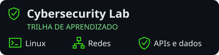
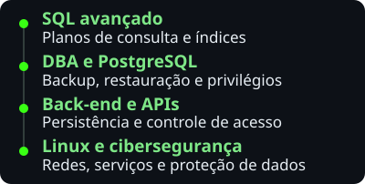
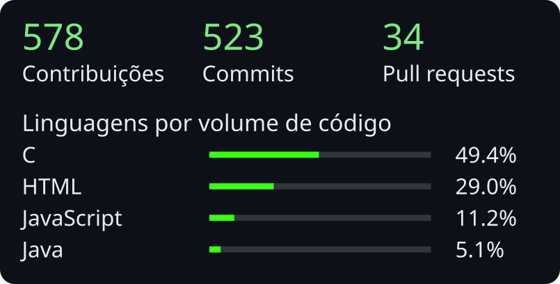

# Kauê de Carvalho Nascimento

**DBA em formação · Banco de Dados e Back-end · Recife, PE**

Estudo Análise e Desenvolvimento de Sistemas na **Faculdade Senac Pernambuco**. Tenho interesse em como os dados são modelados, protegidos e disponibilizados por APIs REST. Integro o **COMPET Superior 2026 da FACEPE**, no projeto institucional Agenda Saúde Digital Tacaratu.


**Busco minha primeira oportunidade profissional, em estágio ou vaga júnior, com foco em Banco de Dados ou Back-end.**

[](https://www.linkedin.com/in/kauedecarvalho/)
[](https://lattes.cnpq.br/1619694344615298)
[](https://orcid.org/0009-0000-1827-4606)
[](mailto:kauecarvnascimento@gmail.com)

## `~/projetos`

[](https://github.com/kauebrpe/agenda-saude-tacaratu-mvp)

Como atividade acadêmica individual, desenvolvi um protótipo demonstrativo para consultar campanhas e ações de saúde em Tacaratu. A interface consome uma API REST em **Node.js e Express**, com filtros por categoria, dados demonstrativos e testes automatizados. [Ver código, documentação e testes](https://github.com/kauebrpe/agenda-saude-tacaratu-mvp)


Participo do desenvolvimento de um sistema de gestão para confecções. A aplicação acompanha clientes, pedidos e prazos, reúne indicadores e exporta dados em CSV. O back-end usa **Java, Spring Boot, JPA e MySQL**, com migrações em Flyway e interface em React. *Repositório privado.*

[](https://github.com/kauebrpe/ADS_FACULDADE)

Atividades da graduação em programação, desenvolvimento web e bancos relacionais. [Consultar exercícios](https://github.com/kauebrpe/ADS_FACULDADE)

## `mysql>` Banco de Dados

**Meu foco é SQL e MySQL.** Na graduação, estudo modelagem relacional, cardinalidade e integridade referencial. Pratico DDL para definir tabelas e restrições, DML para inserir e alterar registros, DQL para consultar dados e DTL para controlar transações com `COMMIT` e `ROLLBACK`.


Neste exemplo didático, quero contar os pedidos por cliente e incluir também os clientes que ainda não fizeram pedidos.

```sql
SELECT c.id, c.nome, COUNT(p.id) AS total_pedidos
FROM cliente AS c
LEFT JOIN pedido AS p ON p.cliente_id = c.id
GROUP BY c.id, c.nome
ORDER BY total_pedidos DESC, c.id;
```

**Aprofundamento em DBA.** Quero avaliar índices com `EXPLAIN`, otimizar consultas, praticar backup e restauração e estudar segurança de bancos relacionais.

## `~/stack` Tecnologias aplicadas

**Banco de dados e fundamentos de programação**  


**Back-end e APIs REST** · Persistência com JPA e migrações com Flyway.  


**Interfaces web**  


**Versionamento e ambiente de desenvolvimento**  


## `~/security-lab` Objetivos de aprendizado



- **Linux e redes** — estudar permissões, processos, serviços e comunicação entre aplicações.
- **Segurança de aplicações e APIs** — entender como a autenticação identifica o usuário e como a autorização limita o acesso a cada recurso.
- **Segurança de bancos de dados** — praticar privilégios mínimos e estudar integridade e proteção dos dados.

## `~/formacao` Formação acadêmica


**Tecnologia em Análise e Desenvolvimento de Sistemas** · Faculdade Senac Pernambuco  
Março de 2026 a setembro de 2027 (conclusão prevista).

**Extensão tecnológica** · Selecionado para integrar o projeto institucional *Agenda Saúde Digital Tacaratu* pelo **COMPET Superior 2026 — FACEPE**, voltado ao desenvolvimento de soluções para a saúde pública.

**Cursos complementares · Curso em Vídeo**  


**Idiomas** · Português nativo · Inglês básico · Espanhol básico

## `~/roadmap` Desenvolvimento profissional



## `git log` Atividade no GitHub



Contagens dos últimos 12 meses segundo o GitHub. As linguagens representam o volume de código nos meus repositórios públicos próprios, excluindo forks. [Consultar atividade no perfil](https://github.com/kauebrpe#year-list-container)

<details open>
<summary>Snake de contribuições · recolher ou expandir</summary>


</details>

## `~/contato`

[](https://www.linkedin.com/in/kauedecarvalho/)
[](https://lattes.cnpq.br/1619694344615298)
[](https://orcid.org/0009-0000-1827-4606)
[](mailto:kauecarvnascimento@gmail.com)


